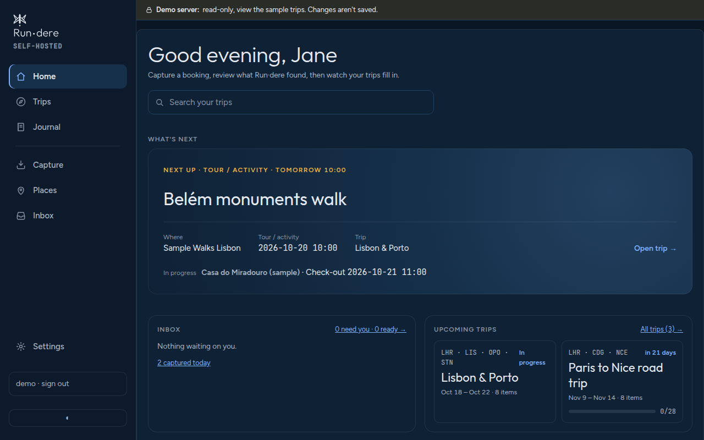
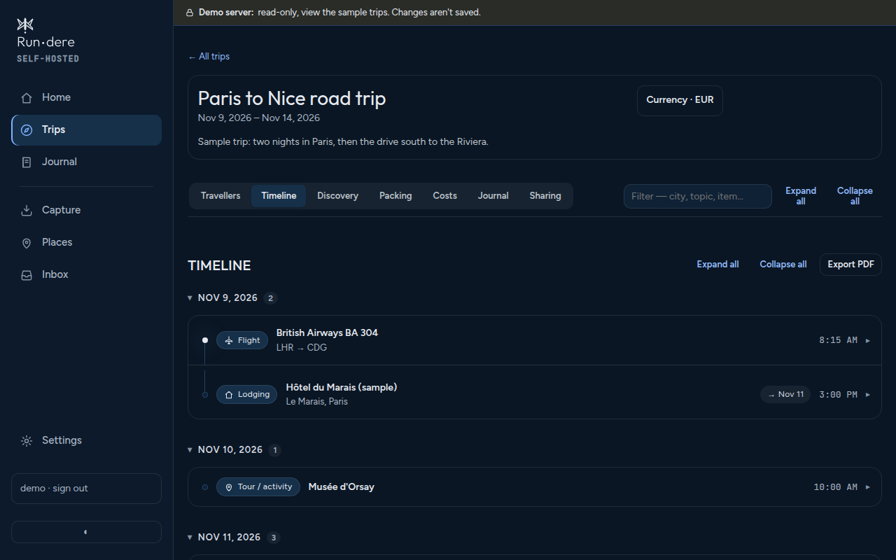

<p align="center">
  <picture>
    <source media="(prefers-color-scheme: dark)" srcset="design/logo/rundere-lockup-horizontal-silver.svg">
    
  </picture>
</p>

# Run·dere

**Version 4.12.9** · [AGPL-3.0](LICENSE) · [changelog](https://github.com/jeeves5454/rundere-server/releases) · [demo](https://demo.rundere.app) · [rundere.app](https://rundere.app)

**A self-hosted travel planner for you and the people you travel with.** Forward a booking
email, drop in a PDF or click a bookmarklet, and Run·dere reads the flight, hotel, train or
tour out of it, asks you to check it, and puts it on the right trip. Each trip gets a
timeline, a map, research for the destination, a packing list, shared costs and a travel
journal. It runs on your own server, and the reading is done by structured parsers and a
local LLM, so your bookings stay with you.

Say it "run there". Plain-text spelling: Rundere.

<p align="center">
  
  
</p>

## What it does

- **Capture from anywhere.** Email forwarding, file upload (PDF, `.ics`, `.eml`), a
  bookmarklet, Gmail and Google Calendar add-ons, the iPhone and iPad app, and AI
  assistants over MCP.
- **Read it reliably.** Structured readers go first (schema.org booking markup, calendar
  invites, PDF text, Google and Apple Maps links). Only free-form text goes to the LLM,
  which runs on your own hardware.
- **Review before anything changes.** Everything lands in the **Inbox**, sorted by what
  needs you. Nothing reaches a trip until you approve it, and your corrections stick.
- **Plan the trip.** A timeline and map, **Discover** research (weather, currency, plugs,
  visa, safety, food and drink, local phrases), packing lists, budgets and shared expenses,
  and a private travel journal.
- **Travel together.** Several people on one server, each seeing only their own trips and
  the ones shared with them. Sharing can be view-only.
- **Use what you already have.** Optionally also log flights to
  [AirTrail](https://github.com/johanohly/AirTrail) and trips to
  [AdventureLog](https://github.com/seanmorley15/AdventureLog). Run·dere works fully
  without them.

## Try the demo

**[demo.rundere.app](https://demo.rundere.app)** is a read-only server with three invented
trips that move forward with the calendar. The sign-in page shows the shared login.

## Install

Run·dere is one container plus a Postgres database, behind a reverse proxy that handles
HTTPS.

```bash
curl -O https://raw.githubusercontent.com/jeeves5454/rundere-server/main/deploy/docker-compose.example.yml
# replace every CHANGE_ME (database password, TX_JWT_SECRET, TX_SECRETS_KEY:
# openssl rand -base64 32) and the example hostnames
docker network create proxy   # unless your reverse proxy already has one
docker compose -f docker-compose.example.yml up -d
```

Then open the server in a browser. The first visit creates the admin account (D-203), so
do that before anyone else can reach it.

- **[Self-hosting guide](docs/self-hosting.md)**: secrets, the proxy, sign-in, optional
  services, backups and upgrades.
- **[Running a demo server](docs/demo-server.md)** of your own.
- To work on the code, see [CONTRIBUTING.md](CONTRIBUTING.md).

## Privacy

- **Your data stays on your server.** Run·dere has no cloud service and sends nothing
  home.
- **Extraction is local.** Bookings are read by parsers and by the LLM you host (Ollama).
  No booking is sent to a cloud AI unless you connect an assistant yourself.
- **A few public lookups, all replaceable.** By default the server fetches map tiles from
  OpenStreetMap, weather from Open-Meteo and exchange rates from Frankfurter. Each can be
  pointed at your own mirror ([configuration](docs/configuration.md)).
- **People are kept apart.** Each person sees their own trips and the ones shared with
  them, and journals are never shared. Admins can see people's trips to help run the
  server, and anyone can turn that off for their own account.
- **Less is kept.** No photos, receipts or audio are stored (journal photos are links).
  Original captures and uploaded files are deleted 12 months after their trip ends, by
  default (D-196).
- Integration tokens are encrypted at rest, and URLs the server fetches for you are
  checked so they can't reach your private network (D-151, D-152).

## Capture

| Way in | Setup |
|---|---|
| Capture page and bookmarklet | Nothing. Paste a page, a URL or a Maps directions link, or click the bookmarklet on a booking page |
| File upload | A folder for files and a ClamAV scanner |
| Email forward | A mailbox the server reads; each person forwards to their own address |
| Gmail and Calendar add-ons | Your own Apps Script copy and a personal key |
| iPhone and iPad app, AI assistants | Sign in from the app, or connect `/mcp` |

In the app, **Capture → Set up** walks through each one. **[docs/capture.md](docs/capture.md)**
covers them all, including the signed `/ingest` endpoint for scripts.

## Workflow

1. **Capture** a booking.
2. Run·dere **reads it on its own** and matches it to a trip.
3. **Check it in the Inbox**, fix anything, and approve.
4. It appears on the trip's **timeline**, and in AirTrail or AdventureLog if you've
   connected them.
5. **Plan** with Discover, packing, costs and the journal.

**[docs/workflow.md](docs/workflow.md)** has the details and alerts for admins.
**[docs/howto.md](docs/howto.md)** walks through each screen.

## Configuration

Everything is set with `TX_*` environment variables, and secrets can come from Docker
secret files. The essentials:

| Setting | What it's for |
|---|---|
| `TX_DATABASE_URL` | Postgres in production (SQLite for development) |
| `TX_JWT_SECRET`, `TX_SECRETS_KEY` | Signing sign-ins, and encrypting each person's integration tokens |
| `TX_PUBLIC_BASE_URL` | Your public address, for email links, the app and AI assistants |
| `TX_OLLAMA_URL`, `TX_PHOTON_URL`, `TX_SEARXNG_URL` | Optional local LLM, geocoder and web search |
| `TX_OIDC_*` | Optional single sign-on (Authentik, Keycloak, …) |

**[docs/configuration.md](docs/configuration.md)** is the full reference.

## Apps and assistants

- **iPhone and iPad.** The native app is in its own repository and talks to this
  server's API. [rundere.app](https://rundere.app) has the details.
- **AI assistants.** The server has a built-in MCP endpoint at `/mcp` with OAuth sign-in,
  so Claude and other MCP clients can read your trips, add to them and save research,
  acting as you. Nothing is connected unless you connect it
  ([docs/claude-connector.md](docs/claude-connector.md)).

## Documentation

Guides are in [`docs/`](docs/) until the project has a wiki:

| | |
|---|---|
| [Self-hosting](docs/self-hosting.md) · [Configuration](docs/configuration.md) | Running a server |
| [Capture](docs/capture.md) · [Email forward](docs/email-forward.md) · [Email](docs/email.md) | Getting bookings in |
| [Workflow](docs/workflow.md) · [How-to](docs/howto.md) | Using it day to day |
| [AI assistants](docs/claude-connector.md) · [Demo server](docs/demo-server.md) | Extras |
| [Architecture](docs/architecture.md) · [Decisions](DECISIONS.md) · [Rules](RULES.md) | How it works and why |

## Contributing and security

Contributions are welcome. Start with [CONTRIBUTING.md](CONTRIBUTING.md) and the
[code of conduct](CODE_OF_CONDUCT.md). Please report vulnerabilities privately as
[SECURITY.md](SECURITY.md) describes.

The project was called **Yonder** until 2026. The Python package, the `TX_*` settings and
some code keep that name on purpose (D-206). Releases up to 4.3.x were published as
`ghcr.io/jeeves5454/yonder`.

## Licence

[GNU Affero General Public License v3.0](LICENSE). If you run a modified Run·dere for
others, you must offer them its source; the **About** page links to it (D-202).
Run·dere talks to AirTrail and AdventureLog over their APIs and doesn't include their code.
[THIRD_PARTY_NOTICES.md](THIRD_PARTY_NOTICES.md) lists the work it builds on.
